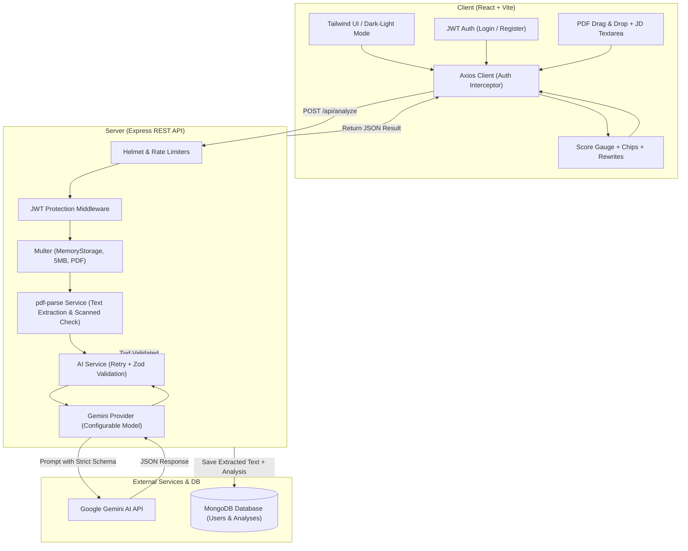

# ResumeMatch AI

[](https://nodejs.org/)
[](https://react.dev/)
[](https://vitejs.dev/)
[](https://tailwindcss.com/)
[](https://www.mongodb.com/)
[](https://ai.google.dev/)
[](LICENSE)

**ResumeMatch AI** is a production-quality, full-stack ATS (Applicant Tracking System) optimization platform. It bridges the gap between job seekers and recruiter screening algorithms by comparing PDF resumes against target job postings. 

Powered by **Google Gemini** with strict Zod schema validation, ResumeMatch AI computes match density, isolates missing keywords, provides section-by-section critiques, and rewrites weak resume bullet points using proven **XYZ achievement frameworks**—without ever fabricating work experience.

---

## Table of Contents
1. [Project Overview](#project-overview)
2. [Key Features](#key-features)
3. [Tech Stack](#tech-stack)
4. [System Architecture](#system-architecture)
5. [Screenshots](#screenshots)
6. [Folder Structure](#folder-structure)
7. [Environment Variables](#environment-variables)
8. [Setup & Local Development](#setup--local-development)
9. [API Endpoints Reference](#api-endpoints-reference)
10. [AI Logic & Guardrails](#ai-logic--guardrails)
11. [Deployment Guide](#deployment-guide)
    - [MongoDB Atlas](#1-mongodb-atlas-setup)
    - [Backend on Render](#2-backend-deployment-render)
    - [Frontend on Vercel](#3-frontend-deployment-vercel)
12. [Future Improvements](#future-improvements)

---

## Project Overview

Modern Applicant Tracking Systems automatically discard up to 75% of qualified resumes due to formatting issues, keyword omissions, and passive phrasing. **ResumeMatch AI** provides candidates with real-time feedback before they apply:

- **100-Point Match Score:** Calibrated evaluation measuring direct qualifications, technical competencies, and role experience.
- **Keyword & Skill Gap Analysis:** Categorized display of matched proficiencies (green chips) and critical omitted keywords (red chips).
- **Targeted Section Feedback:** Granular guidance for the summary, technical skills, employment experience, and personal projects.
- **Original vs. Improved Bullets:** Before-and-after bullet point comparisons rewritten into action-driven statements with one-click clipboard copying.
- **Top 5 Action Items:** Ranked list of strategic modifications to immediately increase callback likelihood.

---

## Key Features

- **In-Memory PDF Parsing:** Uses `pdf-parse` with Multer memory storage. Uploaded PDF files are never stored to disk, ensuring user privacy.
- **Defensive Error Handling:** Explicit detection for scanned/image-only PDFs with no legible text, rate limiting, and oversized files (up to 5 MB).
- **Zod Schema Enforcement:** All LLM outputs are validated against a strict Zod schema with an automatic single-retry fallback on format discrepancy.
- **Swappable AI Provider:** Abstracted AI service architecture allowing seamless migration between Gemini models or alternative LLM providers.
- **JWT Authentication:** Secure user registration, login, and route protection using bcrypt password hashing and token persistence.
- **History & Revisit:** User dashboard archiving past analyses with search, one-click report reopening, and deletion.
- **Print & PDF Export:** Clean print stylesheet (`@media print`) and button to download or print formatted evaluation reports.
- **Responsive Dark/Light UI:** Built with Tailwind CSS and Lucide React icons, featuring smooth system/manual theme toggle.

---

## Tech Stack

| Layer | Technologies |
| :--- | :--- |
| **Frontend** | React 18, Vite, React Router v6, Tailwind CSS, Recharts, Lucide React, Axios |
| **Backend** | Node.js, Express.js (ES Modules) |
| **Database** | MongoDB with Mongoose ODM |
| **Authentication** | JSON Web Tokens (JWT), bcryptjs |
| **PDF Extraction** | `pdf-parse`, `multer` (Memory storage, max 5 MB, PDF MIME only) |
| **AI Integration** | Google Gemini API (`@google/generative-ai`), model configurable via `GEMINI_MODEL` |
| **Validation** | Zod (Runtime JSON schema validation & API request validation) |
| **Security** | Helmet, CORS origin restriction, Express Rate Limit (strict on `/api/analyze`) |

---

## System Architecture



---

## Screenshots

> *Placeholder: Add screenshots of your application in action below.*

| Analyze Screen | Results Screen (Gauge & Feedback) |
| :---: | :---: |
|  |  |

| Original vs Improved Bullets | History Dashboard |
| :---: | :---: |
|  |  |

---

## Folder Structure

```
resume-match-ai/
├── client/                      # Frontend Application (React + Vite)
│   ├── public/                  # Static assets
│   ├── src/
│   │   ├── components/          # Reusable UI components
│   │   │   ├── ActionList.jsx       # Top 5 priority action cards
│   │   │   ├── BulletComparison.jsx # Original vs Improved diff cards
│   │   │   ├── Footer.jsx           # Application footer
│   │   │   ├── Navbar.jsx           # Responsive navigation + theme toggle
│   │   │   ├── ProtectedRoute.jsx   # Auth route guard
│   │   │   ├── ScoreGauge.jsx       # Recharts circular match score
│   │   │   ├── SectionFeedback.jsx  # Summary/skills/exp feedback cards
│   │   │   └── SkillChips.jsx       # Matched (green) & missing (red) chips
│   │   ├── context/
│   │   │   ├── AuthContext.jsx      # Session & token state management
│   │   │   └── ThemeContext.jsx     # Dark/light theme provider
│   │   ├── pages/
│   │   │   ├── AnalyzePage.jsx      # PDF upload + JD input + error states
│   │   │   ├── HistoryPage.jsx      # Past analyses list & search
│   │   │   ├── HomePage.jsx         # Landing page & feature showcase
│   │   │   ├── LoginPage.jsx        # Login with demo filler
│   │   │   ├── NotFoundPage.jsx     # 404 handler
│   │   │   ├── RegisterPage.jsx     # User account creation
│   │   │   └── ResultsPage.jsx      # Analysis view + print layout
│   │   ├── services/
│   │   │   ├── api.js               # Axios instance with interceptors
│   │   │   └── authService.js       # Auth and analysis endpoints
│   │   ├── utils/
│   │   │   └── formatDate.js        # Date and score color formatters
│   │   ├── App.jsx                  # Main router config
│   │   ├── index.css                # Tailwind directives & print CSS
│   │   └── main.jsx                 # React root mount
│   ├── .env.example
│   ├── index.html
│   ├── package.json
│   ├── postcss.config.js
│   ├── tailwind.config.js
│   └── vite.config.js
│
├── server/                      # Backend Application (Node + Express)
│   ├── src/
│   │   ├── config/
│   │   │   └── db.js                # Mongoose connection
│   │   ├── controllers/
│   │   │   ├── analysisController.js# Analyze, list, get, delete controllers
│   │   │   └── authController.js    # Register, login, getMe controllers
│   │   ├── middleware/
│   │   │   ├── authMiddleware.js    # JWT bearer verification
│   │   │   ├── errorHandler.js      # Centralized error handler
│   │   │   ├── rateLimiter.js       # Rate limiters (general, auth, analyze)
│   │   │   └── uploadMiddleware.js  # Multer 5MB PDF filter
│   │   ├── models/
│   │   │   ├── Analysis.js          # Stored analysis MongoDB schema
│   │   │   └── User.js              # User schema with bcrypt methods
│   │   ├── routes/
│   │   │   ├── analysisRoutes.js    # Analysis routes
│   │   │   └── authRoutes.js        # Auth routes
│   │   ├── services/
│   │   │   ├── aiService.js         # AI coordination, retry & Zod validation
│   │   │   ├── geminiProvider.js    # Google Gemini API provider
│   │   │   └── pdfService.js        # pdf-parse & scanned PDF detection
│   │   ├── utils/
│   │   │   ├── aiPrompt.js          # Strict anti-hallucination system prompt
│   │   │   └── validationSchemas.js # Zod schemas for input & output
│   │   └── index.js                 # Express server entry point
│   ├── .env.example
│   └── package.json
│
├── samples/                     # Test Samples
│   ├── sample-resume.txt        # Full stack engineer sample resume
│   ├── sample-job-description.txt # Senior engineer target job description
│   ├── sample-resume.pdf        # Pre-generated PDF ready for drag & drop
│   └── create-sample-pdf.mjs    # Pure-Node sample PDF generator
│
├── .gitignore
├── eslint.config.js
└── README.md
```

---

## Environment Variables

### Server (`server/.env`)

Create `server/.env` based on `server/.env.example`:

```env
# Server Port
PORT=5000

# MongoDB Connection String (Local or Atlas)
MONGODB_URI=mongodb://localhost:27017/resumematch

# JWT Configuration
JWT_SECRET=your_super_secret_jwt_key_change_in_production
JWT_EXPIRES_IN=7d

# Google Gemini API
GEMINI_API_KEY=your_gemini_api_key_here
GEMINI_MODEL=gemini-1.5-flash

# Frontend Origin for CORS
CLIENT_ORIGIN=http://localhost:5173
```

> **Note on `GEMINI_MODEL`:** You can freely swap this to `gemini-1.5-flash`, `gemini-1.5-pro`, `gemini-2.0-flash`, or future Gemini model versions without changing any code.

### Client (`client/.env`)

Create `client/.env` based on `client/.env.example`:

```env
# API Base URL (Default proxies to /api during Vite local development)
VITE_API_BASE_URL=http://localhost:5000/api
```

---

## Setup & Local Development

### Prerequisites
- **Node.js** v18+ (tested on Node v20/v22/v24)
- **MongoDB** running locally (`mongod`) or a free [MongoDB Atlas](https://www.mongodb.com/atlas) cluster URI
- **Google Gemini API Key** (obtainable free from [Google AI Studio](https://aistudio.google.com/))

### 1. Clone & Enter Project Directory
```bash
cd "c:\new project"
```

### 2. Configure Server Environment
```bash
cd server
cp .env.example .env
# Edit server/.env and insert your GEMINI_API_KEY and MONGODB_URI
npm install
```

### 3. Configure Client Environment
```bash
cd ../client
cp .env.example .env
npm install
```

### 4. (Optional) Re-generate Sample PDF
If you wish to test immediate file upload:
```bash
cd ..
node samples/create-sample-pdf.mjs
# This creates samples/sample-resume.pdf
```

### 5. Start Backend Server
```bash
cd server
npm run dev
# Server starts at http://localhost:5000
```

### 6. Start Frontend Development Server (In a separate terminal)
```bash
cd client
npm run dev
# Vite runs at http://localhost:5173
```

Visit **http://localhost:5173** in your browser.

---

## API Endpoints Reference

| Method | Endpoint | Auth | Description |
| :--- | :--- | :---: | :--- |
| `POST` | `/api/auth/register` | No | Register new candidate (`name`, `email`, `password`) |
| `POST` | `/api/auth/login` | No | Authenticate user & receive JWT token |
| `GET` | `/api/auth/me` | Bearer | Fetch profile of currently authenticated user |
| `POST` | `/api/analyze` | Bearer | Multipart upload (`resume` PDF file + `jobDescription` string) |
| `GET` | `/api/analyses` | Bearer | List past analyses for logged-in user (descending by date) |
| `GET` | `/api/analyses/:id` | Bearer | Get complete evaluation report by ID |
| `DELETE` | `/api/analyses/:id` | Bearer | Delete analysis report from user history |
| `GET` | `/health` | No | Server health check endpoint |

---

## AI Logic & Guardrails

The application enforces rigid prompts and programmatic verification:

1. **Strict Anti-Hallucination Prompting:** The prompt forbids fabricating credentials, metrics, or technologies not present in the candidate's resume.
2. **Measurable Outcome Rule:** Improved bullet points utilize the **Google XYZ formula** (*Accomplished [X] as measured by [Y] by doing [Z]*). Metrics are only included if the original resume provides a baseline or scope.
3. **Zod Runtime Schema Validation:**
   ```json
   {
     "matchScore": number,
     "jobTitle": string,
     "matchedSkills": string[],
     "missingKeywords": string[],
     "sectionFeedback": {
       "summary": string,
       "skills": string,
       "experience": string,
       "projects": string
     },
     "improvedBullets": [
       { "original": string, "improved": string, "reason": string }
     ],
     "topActions": string[]
   }
   ```
4. **Resilient Retry Protocol:** If the LLM produces invalid JSON, the service retries once with explicit JSON constraints before returning a user-friendly error message.
5. **Scanned PDF Guard:** If `pdf-parse` extracts fewer than 40 alphanumeric characters, the request is flagged with `isScannedPdf: true`, informing the user that image-only PDFs cannot be read by ATS parsers.

---

## Deployment Guide

### 1. MongoDB Atlas Setup
1. Create a free M0 cluster at [mongodb.com/atlas](https://www.mongodb.com/atlas).
2. Under **Database Access**, create a user with read/write privileges.
3. Under **Network Access**, whitelist `0.0.0.0/0` (allow access from anywhere) or your specific host IP.
4. Copy your connection string: `mongodb+srv://<username>:<password>@cluster0.xxxxx.mongodb.net/resumematch?retryWrites=true&w=majority`.

### 2. Backend Deployment (Render)
1. Push your repository to GitHub.
2. Go to [Render Dashboard](https://dashboard.render.com/) and create a **New Web Service**.
3. Connect your repository and configure:
   - **Root Directory:** `server`
   - **Build Command:** `npm install`
   - **Start Command:** `npm start`
4. In the **Environment Variables** section, add:
   - `PORT`: `5000` (or leave default)
   - `NODE_ENV`: `production`
   - `MONGODB_URI`: *Your MongoDB Atlas connection URI*
   - `JWT_SECRET`: *A secure random 32+ character string*
   - `GEMINI_API_KEY`: *Your Google Gemini API key*
   - `GEMINI_MODEL`: `gemini-1.5-flash`
   - `CLIENT_ORIGIN`: *Your Vercel frontend URL, e.g., `https://resumematch-ai.vercel.app`*
5. Click **Deploy Web Service**. Copy the generated URL (e.g., `https://resumematch-api.onrender.com`).

### 3. Frontend Deployment (Vercel)
1. Go to [Vercel](https://vercel.com/) and click **Add New Project**.
2. Select your repository.
3. In the project settings:
   - **Framework Preset:** Vite
   - **Root Directory:** `client`
   - **Build Command:** `npm run build`
   - **Output Directory:** `dist`
4. Add the **Environment Variable**:
   - `VITE_API_BASE_URL`: `https://resumematch-api.onrender.com/api` (Render backend URL with `/api`)
5. Click **Deploy**. Your production application is now live!

---

## Future Improvements

- [ ] **ATS Direct Parsing Simulation:** Add visual simulation showing how legacy Taleo/Workday parsers slice applicant text.
- [ ] **Tailored Cover Letter Generator:** Generate a customized, keyword-dense cover letter corresponding to the gap analysis.
- [ ] **Multi-Format Ingestion:** Add support for `.docx` and LinkedIn profile PDF imports.
- [ ] **Job Board Extension:** Chrome extension to auto-grab job descriptions directly from LinkedIn, Indeed, or Greenhouse into the analyze screen.
- [ ] **Version Diffing:** Compare multiple iterations of a resume side-by-side to track score increases over time.

---

## License

This project is licensed under the MIT License. See [LICENSE](LICENSE) for details.
